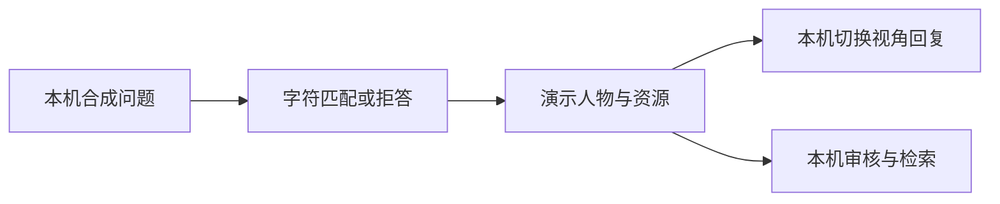

# 留光——AI 驱动的全球留学成长社区

留光面向准留学生、海外在读学生与校友，围绕同校同专业伙伴连接、真实经验共建、人与资源匹配展开。项目已选新东方国际教育企业命题。伦敦新生是当前 Demo 的示例场景。详见[原报名文案](文档/留光报名文案.md)。

## 当前交付：M0 社区风格样张

[总指令](docs/brief/总指令.md) · [命题书全文](docs/brief/命题书.md) · [里程碑](docs/PLAN.md) · [进度与人工作业](docs/PROGRESS.md) · [决策](docs/DECISIONS.md)。

运行下方本地服务器，打开 [/styleguide/](http://127.0.0.1:8764/styleguide/) 切换琥珀手记和松绿同窗录。已有[两款样张的三尺寸截图](docs/design/screenshots/M0/)。尚无公开体验地址或评审账号；双账号五分钟路径需等真实服务可用后验证。团队人数和分工由报名负责人核定。

```sh
pnpm install --frozen-lockfile
pnpm lint && pnpm typecheck && pnpm test && pnpm check:ui && pnpm build
uv run --with-requirements requirements-test.txt -- pnpm test:e2e
```

要求 Node 24、pnpm 11.25.0、Python 3.12 和 Chrome，或使用 Playwright Chromium。M0 使用原生网页、Python 打包与 Playwright 浏览器测试；新增质量工具使用严格 TypeScript。当前旧版架构和计划中的服务端不可混用：



服务端拟由邀请码入驻、社区问答、经同意的经验卡片、混合检索与可核验的重排理由衔接；各环节分别记录模型输出、授权与反馈。参见[原型流程](文档/工作流与架构.md)和[技术决定](docs/DECISIONS.md)。

## 命题要求对照

| 要求 | 当前证据 | 正式验收 |
|---|---|---|
| 身份/主页、学校专业社区、问答、校友连接 | 离线版可切角色；非真实交流 | M1 双账号及权限 E2E，M4 去标识化连接记录 |
| 经验上传、标签/检索、摘要/分类、课程资源 | 离线链接投稿，未接真实文件与在线模型 | M2 资源共建 E2E、授权与审核记录 |
| AI 人与资源匹配、理由与反馈 | 离线主题分类和样张；尚无实测效果 | M2 匹配 E2E，M5 同题盲评与流转案例 |
| 举报、纠错、审核 | 演示投稿核对不等于治理后台 | M2–M4 服务端权限、处理与申诉记录 |
| 真实测试、AI 全流程与通用/专属材料 | [研究包](docs/research/访谈提纲.md)、[AI 日志](docs/ai/ai-usage-log.md)、[逐项交付索引](docs/submission/交付物索引.md) | M4 至少十人、两次模拟评审、M6 数字可追溯 |
| 移动视觉、可验证性 | [M0 截图](docs/design/screenshots/M0/)、Quality 工作流、4 个单元测试和两组浏览器回归 | 微信/4G/海外实测、评审账号五分钟路径待完成 |

赛事背景：2026 全球超级个体（OPC 3.0）创新创业大赛第二赛季，产业命题赛道新东方国际教育题。当前仓库为私有；此处的示例不能作为受试者经历、用户成果或合作方认可的证据。

## 两分钟演示

下载 [内部演示包](https://github.com/HEltDeng/liuguang/releases/tag/v0.1.1)，解压后用 Chrome 或 Safari 打开 HTML。无需安装、注册或配置 API 密钥。需要仓库访问权才能下载。演示本身可离线，查看原始资料需要联网。

1. 点「找自习空间」，查看匹配依据、演示校友和原始来源。
2. 向校友提问，创建昵称名片并保存求助。进入互助记录，切换演示校友视角，手动回复，再以新生身份反馈。
3. 在资源库贡献一条 HTTPS 链接，核对内容、修改分类并发布；通过检索找到它，也可以撤回。
4. 输入“火星基地施工手册”：系统应明确表示没有可靠匹配。

## 从源码运行

在仓库根目录执行：

```sh
python3 -m http.server 8764 --bind 127.0.0.1 --directory '代码/liuguang'
```

访问 http://127.0.0.1:8764 。要生成便携版，运行 `python3 代码/liuguang/build.py`。网页无第三方运行时依赖。交付件由源文件生成，避免两份 UI 漂移。

## 行为与验证

3 个虚构校友、5 个真实公开资料入口、24 条项目自编主题示例。使用浏览器内的 TF-IDF 示例相似度检索；不调用大模型，不代替校友生成回复。不爬取用户提交的网址。名片、咨询、反馈和投稿只保存在当前浏览器，不会发给真实校友或同步到其他设备；文件模式的存储行为取决于浏览器。试点前需要真实身份、权限、服务端存储与审核流程。

使用 Python、uv、Playwright 及 Chrome，先生成便携版再运行：

```sh
uv run --with playwright python 代码/liuguang/tests/check_demo.py
```

非 macOS 可用 `CHROME_BIN` 指定 Chromium 的路径，或安装 Playwright Chromium。验证覆盖主题匹配/拒答、三条快捷问题、用户交互、刷新后的状态、资源审核与撤回，以及 390px 手机布局。在现有样例上的回归通过不代表真实用户准确率。

- [原型范围与提交清单](文档/比赛交付路线.md)
- [匹配流程与系统架构](文档/工作流与架构.md)
- [AI 使用及数据来源记录](文档/AI与数据记录.md)
